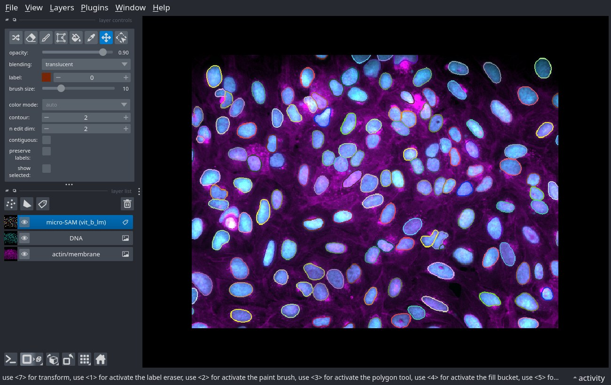
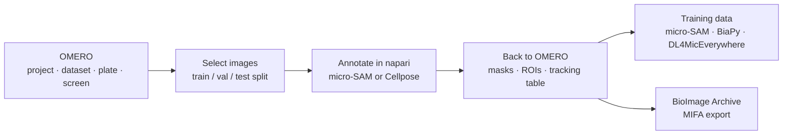
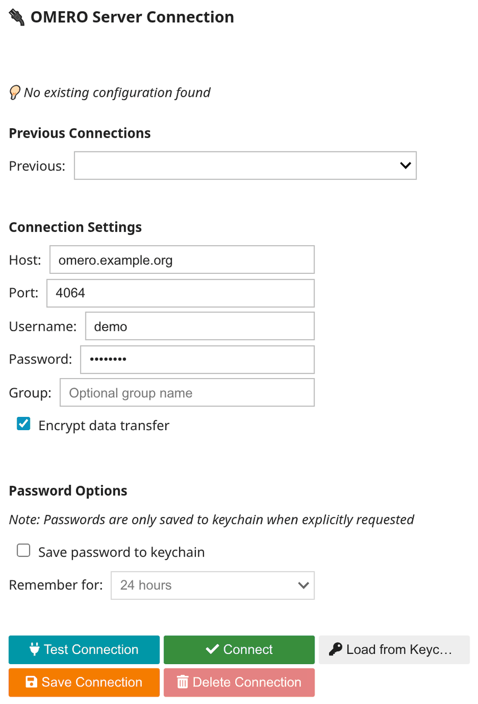
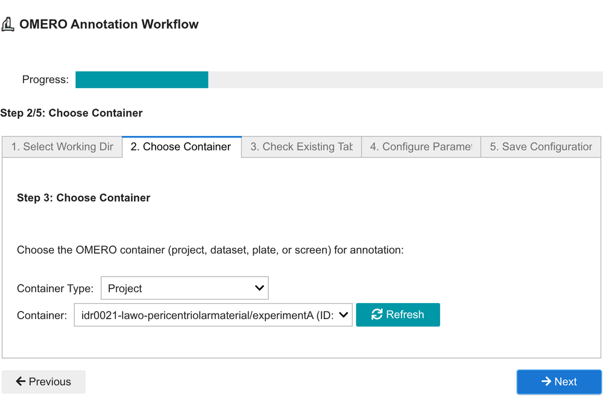
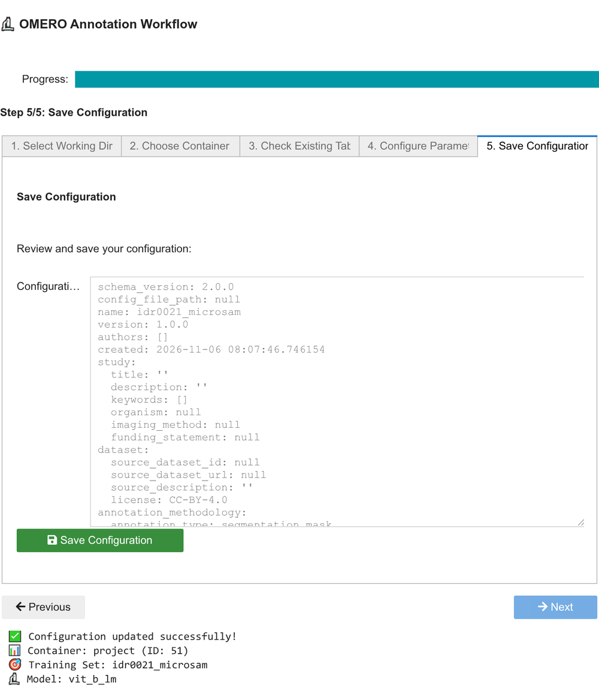

# OMERO Annotate.AI

[](https://pypi.org/project/omero-annotate-ai/)
[](http://bioconda.github.io/recipes/omero-annotate-ai/README.html)
[](https://pypi.org/project/omero-annotate-ai/)
[](https://github.com/Leiden-Cell-Observatory/omero_annotate_ai/actions)
[](https://leiden-cell-observatory.github.io/omero_annotate_ai/)
[](https://pixi.sh)
[](https://github.com/Leiden-Cell-Observatory/omero_annotate_ai/blob/main/LICENSE)

**Reproducible AI-assisted annotation of OMERO data, from image selection to training-ready datasets.**

Pick images from an OMERO project, dataset, plate or screen. Annotate them in napari with
[micro-SAM](https://github.com/computational-cell-analytics/micro-sam) or prepare them for
[Cellpose](https://www.cellpose.org). The masks, ROIs and a tracking table go back to OMERO.
Every run is described by one YAML file, so you can resume it, repeat it or share it.


<sub>micro-SAM (`vit_b_lm`) instance segmentation of nuclei in a Cell Painting field from the BioImage Archive (S-BIAD855), shown in napari.</sub>

## How it works



- **Jupyter widgets** for connecting to OMERO and configuring a run step by step, no code needed.
- **Resumable and crash-safe:** each mask is saved locally, uploaded with a tag and then recorded in the tracking table, so an interrupted run continues where it stopped without duplicate uploads; pixel digests flag files that changed afterwards.
- **Flexible sampling:** timepoints, z-slices, 3D volumes, random patches, and filtering plate wells on their key-value pairs.
- **Training-ready output:** one folder layout for micro-SAM, BiaPy and DL4MicEverywhere, with images and labels paired by name.
- **FAIR by default:** the config carries study and method metadata and exports to the BioImage Archive (MIFA).
- **Read-only mode** for public servers such as the [IDR](https://idr.openmicroscopy.org).

## Jupyter widgets

<table>
  <tr>
    <td width="45%"></td>
    <td width="55%"></td>
  </tr>
  <tr>
    <td><sub>Connect to any OMERO server, here the public IDR.</sub></td>
    <td><sub>Choose a project, dataset, plate or screen.</sub></td>
  </tr>
  <tr>
    <td colspan="2" align="center"><br>
    <sub>Set the parameters and review the YAML config the run will use.</sub></td>
  </tr>
</table>

## Installation

```bash
# Recommended: pixi
pixi init myproject && cd myproject
pixi add micro_sam jupyterlab
pixi add --pypi "omero-annotate-ai[notebooks]"

# Or: conda + pip
conda install -c conda-forge micro_sam jupyterlab
pip install "omero-annotate-ai[notebooks]"

# Or: pip only (micro-SAM and napari from PyPI)
pip install "omero-annotate-ai[microsam,notebooks]" jupyterlab
```

See the [installation guide](https://leiden-cell-observatory.github.io/omero_annotate_ai/installation/) for details and troubleshooting.

## Quick start

**With widgets** (in Jupyter):

```python
from omero_annotate_ai import (
    TrainingSet,
    create_omero_connection_widget,
    create_workflow_widget,
)

conn_widget = create_omero_connection_widget()
conn_widget.display()
conn = conn_widget.get_connection()

workflow_widget = create_workflow_widget(connection=conn)
workflow_widget.display()

config = workflow_widget.get_config()
ts = TrainingSet.create(config, conn)  # or TrainingSet.open(table_id, conn)
ts.annotate(note="nuclei only, small debris skipped")
```

**From a YAML config** (scripts, batch runs, or repeating a run):

```python
from omero_annotate_ai import TrainingSet, load_config

config = load_config("annotation_config.yaml")
ts = TrainingSet.create(config, conn)
ts.annotate()
```

**Continue later** (after closing napari, or a crash): open the set by its table ID and
annotate what is left; anything a crash left half-done is repaired first.

```python
ts = TrainingSet.open(12345, conn)
ts.extend(train_n=10)  # optional: add images to the same table
ts.annotate(note="second round")
```

Each training set keeps its files in one folder: images, masks, `config.yaml` (with the
sessions and their notes) and a local copy of the tracking table. By default that is
`~/omero_annotate_ai/<server>/<table id>_<name>/`; set `OMERO_ANNOTATE_AI_HOME` (or pass
`home=` to `TrainingSet.create` / `open`) to keep the sets elsewhere.
`create_pipeline(config, conn).run_full_micro_sam_workflow()` from 0.4 still works but
is deprecated.

The [configuration guide](https://leiden-cell-observatory.github.io/omero_annotate_ai/configuration/) lists every option.

## Example notebooks

| | Jupyter | marimo |
|---|---|---|
| Annotate with micro-SAM | [widget workflow](notebooks/jupyter/annotation/omero-annotate-ai-annotation-widget.ipynb) | [annotation](notebooks/marimo/omero-annotate-ai-annotation.py) |
| Prepare for Cellpose | [cellpose](notebooks/jupyter/annotation/omero-annotate-ai-cellpose.ipynb) | [cellpose](notebooks/marimo/omero-annotate-ai-cellpose.py) |
| Run from YAML | [from YAML](notebooks/jupyter/annotation/omero-annotate-ai-from-yaml.ipynb) | [from YAML](notebooks/marimo/omero-annotate-ai-from-yaml.py) |
| Train | [micro-SAM](notebooks/jupyter/training/omero-training-microsam.ipynb) · [BiaPy](notebooks/jupyter/training/omero-training_biapy.ipynb) · [DL4MicEverywhere](notebooks/jupyter/training/omero-training_DL4mic.ipynb) | [micro-SAM](notebooks/marimo/omero-training-microsam.py) |
| Export to the BioImage Archive | [BIA export](notebooks/jupyter/export_annotations/omero-table-to-bioimage-archive.ipynb) | |
| Try it on public IDR data | | [IDR demo](notebooks/marimo/omero-idr-demo.py) |

## Documentation

Full documentation: **https://leiden-cell-observatory.github.io/omero_annotate_ai/**
([micro-SAM tutorial](https://leiden-cell-observatory.github.io/omero_annotate_ai/tutorials/microsam-annotation-pipeline/),
[API reference](https://leiden-cell-observatory.github.io/omero_annotate_ai/api/)).

## Contributing

```bash
git clone https://github.com/Leiden-Cell-Observatory/omero_annotate_ai.git
cd omero_annotate_ai
pixi install                         # default env: everything to run the notebooks
pixi run -e dev install-hooks        # once per clone: ruff + notebook-output hooks
pixi run -e dev pytest tests/        # dev env adds test, lint and type-check tools
```

Issues and pull requests are welcome on [GitHub](https://github.com/Leiden-Cell-Observatory/omero_annotate_ai/issues).

## Contact and acknowledgements

**Maarten Paul**, m.w.paul@lacdr.leidenuniv.nl

Developed at the [Leiden Cell Observatory](https://github.com/Leiden-Cell-Observatory) within the
[NL-BioImaging](https://github.com/NL-BioImaging) infrastructure, funded by NWO.

## License

GNU General Public License v2.0 or later (GPL-2.0-or-later); see [LICENSE](LICENSE).
The package builds on [omero-py](https://github.com/ome/omero-py) (GPL-2.0-or-later) and
[ezomero](https://github.com/TheJacksonLaboratory/ezomero) (GPL-2.0), so it uses a compatible
license. Releases up to and including 0.4.x were published under Apache-2.0.
