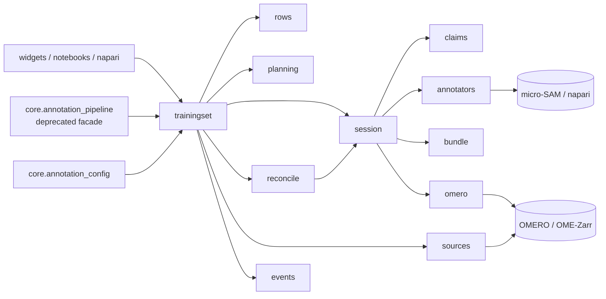

# Architecture

How the package is put together, for contributors. It describes the code as it is now.

| Part | Responsibility |
|---|---|
| `core/annotation_config.py` | A training set's definition (pydantic, schema version 3) and its YAML form: what to annotate and how, plus `identity` (table ID or local ID) and `sessions` (with notes). Rows are not part of it. Removed keys raise `RemovedConfigKey`. |
| `trainingset.py` | `TrainingSet`: create (select images, plan units, create the table) or open (by table ID or folder, repair), annotate, review, extend, notes, external tools (`prepare_external`, `collect_masks` from `external_output/`). Lists images and loads pixels. `OmeroWrites` holds every OMERO call it makes (replaceable in tests). Read-only `list_training_sets` / `summarize`. |
| `rows.py` | `Row`, one per annotation unit, and the one codec between rows and a table (`tracking_table.csv` and the OMERO table). |
| `core/annotation_pipeline.py` | Deprecated `create_pipeline` facade over `TrainingSet`, for older notebooks and scripts. |
| `session.py` | One annotation session, step by step: `next_batch()`, `commit()`, `release()`, `finish()`. Owns the write order of a unit: mask into the bundle, local accept (CSV), upload label then ROI (each ID saved straight away, tagged), table update per commit (only the rows it saved). A review session hands out annotated units with their saved mask and replaces changed ones: new upload first, then the old one deleted. `exclude()` marks units done without mask or uploads (`annotation_type: excluded`): never handed out, reviewed or exported again; a commit in the same session turns one back into an annotation. |
| `claims.py` | Several computers on one OMERO set: a session claims a batch's units in the table (`claimed_by`, `claimed_at`) before showing them, releases them on commit or hand-back. Claims of the same owner (user and computer) never block; others expire after `workflow.claim_hours`. Claims write only the claim cells, and only if they are unchanged since read; `commit()` re-reads each row before uploading and adopts uploads already carrying the unit's tag, so a unit saved elsewhere is never uploaded twice. Failed and conflicting units are unclaimed at once; `collect_masks()` claims like a session. The config on OMERO is merged on publish: other computers' sessions, notes set here, and the larger image counts; the newest config file wins, and a session number taken by another computer at the same moment is renumbered. |
| `reconcile.py` | On resume, compares the OMERO table, the local CSV and the mask files per unit (`decide`) and repairs: adopts tagged uploads, uploads what is missing, finishes an interrupted review (keeps the newer tagged upload that holds the local mask), reports pixel mismatches, leaves excluded units excluded. Idempotent. |
| `events.py` | What a run reports (`UnitCommitted`, `UploadFailed`, `ReconcileAction`, `Progress`, ...) to an `EventSink`; default: logging. Front-ends pass their own. |
| `planning.py` | Pure planning: which images go to which split (`plan_split`), the units of one image (`units_for_image`), and which images to add to a set (`plan_extension`). Every random choice comes from `training.seed` via `rng_for`, so a plan can be reproduced. |
| `annotators.py` | The `Annotator` protocol and its two implementations: `MicroSamAnnotator` (napari, interactive; a review passes the saved masks as micro-SAM's `initial_segmentations`) and `ScriptedAnnotator` (draws masks with a function; for scripts and tests). |
| `sources/` | Reading pixels and image sizes from OMERO or OME-Zarr behind one `ImageSource` protocol. |
| `omero/` | OMERO access: the tracking table (updated in place, so its ID identifies the training set), uploads of ROIs and labels, connections (`ConnectionFailed`), and `delete_training_set` (by table ID and tag, dry run first, refuses other users' objects). |
| `processing/` | Training data export (`export_training_set`: OMERO set via `prepare_training_data_from_table`, local set via `reorganize_local_data_for_training`, by each row's category), normalisation for micro-SAM/BiaPy, and training helpers. |
| `core/mifa_export.py`, `processing/bia_data.py` | MIFA metadata and BioImage Archive bundles from a config plus rows. |
| `widgets/` | ipywidgets front-ends: OMERO connection (keychain, history), the workflow widget (New / Open training set, annotate or review, progress from events, session notes) and table selection for exports. |
| `bundle.py` | Where a training set's files live: one folder per set under the home folder (`$OMERO_ANNOTATE_AI_HOME`, else `~/omero_annotate_ai`), atomic writes, a fresh scratch folder per batch, `annotation_output/` for accepted masks only, masks matched to units by exact file name, and pixel digests. |
| `provenance.py` | Optional ISCC Image-Codes (`provenance` extra, `iscc-lib`) of each unit's image and mask, stored next to the pixel digests; repair and export messages use them to say whether a changed file is a near-duplicate or different content. Without the extra nothing is computed. |
| `crate.py` | `TrainingSet.write_ro_crate()`: the set's folder described as an RO-Crate 1.1 (`ro-crate-metadata.json`): files with digests and ISCC codes, source images by URI, sessions as actions with agent, model and note. Written on request, not per commit. |
| `errors.py` | The package's exceptions; all derive from `OmeroAnnotateAIError`. |

**Rules of thumb**

- `planning.py`, `annotators.py`, `bundle.py`, `errors.py`, `events.py`, `session.py`,
  `reconcile.py` and `claims.py` are type-checked strictly (pyright); nothing in the core prints. The
  workflow widget only holds form state: it builds a request that `open_or_create`
  turns into a `TrainingSet`, and shows progress from the events.
- A protocol needs two real implementations before it is introduced.
- Tests: unit tests mirror the modules (`tests/test_planning.py`, `tests/test_rows.py`,
  `tests/test_trainingset.py`, `tests/test_session.py`, `tests/test_reconcile.py`, ...) and use the in-memory OMERO in
  `tests/fakes.py`, which can fail or "crash" any call; `tests/test_functional_workflow.py`
  runs the whole workflow against a Docker OMERO and is the acceptance suite.
