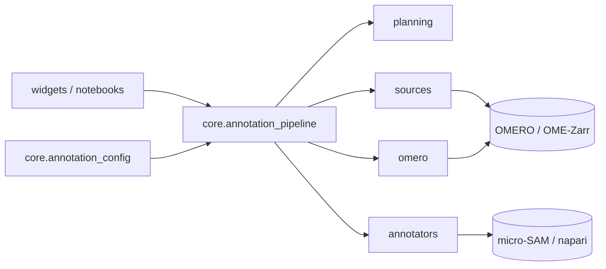

# Architecture

How the package is put together, for contributors. It describes the code as it is now;
it changes as the 0.5.0 core rewrite lands.

| Part | Responsibility |
|---|---|
| `core/annotation_config.py` | The configuration (pydantic), its YAML form and the per-unit records (`ImageAnnotation`). |
| `core/annotation_pipeline.py` | Runs a workflow: lists images, plans units, loads pixels, calls the annotator, saves masks, uploads to OMERO and updates the tracking table. |
| `planning.py` | Pure planning: which images go to which split (`plan_split`), the units of one image (`units_for_image`), and which images to add to a set (`plan_extension`). Every random choice comes from `training.seed` via `rng_for`, so a plan can be reproduced. |
| `annotators.py` | The `Annotator` protocol and its two implementations: `MicroSamAnnotator` (napari, interactive) and `ScriptedAnnotator` (draws masks with a function; for scripts and tests). |
| `sources/` | Reading pixels and image sizes from OMERO or OME-Zarr behind one `ImageSource` protocol. |
| `omero/` | OMERO access: the tracking table (updated in place, so its ID identifies the training set), uploads of ROIs and labels, connections. |
| `processing/` | Training data export and training helpers. |
| `errors.py` | The package's exceptions; all derive from `OmeroAnnotateAIError`. |

**Rules of thumb**

- `planning.py`, `annotators.py` and `errors.py` are type-checked strictly (pyright) and
  must not print; the pipeline and widgets are older code being replaced step by step.
- A protocol needs two real implementations before it is introduced.
- Tests: unit tests mirror the modules (`tests/test_planning.py`,
  `tests/test_annotators.py`, ...); `tests/test_functional_workflow.py` runs the whole
  workflow against a Docker OMERO and is the acceptance suite.
