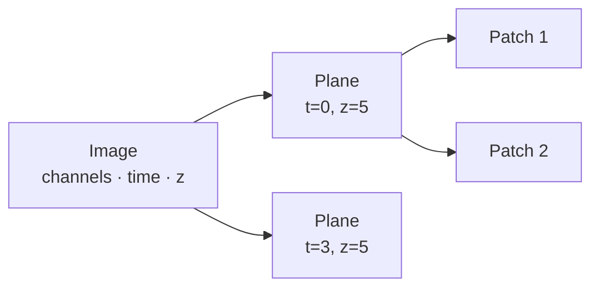

# How it works

A short tour of the ideas you will meet in the widgets, the YAML file and the rest of
these docs.

## The run and its config

Each annotation project is a **run**, described by one **configuration file** (YAML).
It says which OMERO container to take images from, which channel to annotate, how many
images go into the training and validation sets, and where to put local files. You can
create it with the Jupyter widget or write it by hand; see the
[configuration reference](configuration.md).

While you annotate, the pipeline writes progress into a copy of that file
(`annotation_config_<name>.yaml` in your output folder). That copy is what lets you
[resume or repeat a run](tutorials/resume-and-repeat.md).

## Where images come from

Images are read directly from an **OMERO container**: a project, dataset, plate, screen or
a single image. For plates you can keep only wells with certain key-value pairs, for
example `treatment: DMSO`.

## Annotation units

You rarely annotate a whole multi-dimensional image. The pipeline cuts each image into
**annotation units**: one 2D plane (a chosen channel, timepoint and z-slice), or one 3D
volume if you switch on 3D mode. With **patches** switched on, each plane is further cut
into smaller crops (for example 512 × 512 pixels), which are quicker to annotate and to
process on a CPU.



Every unit gets an ID such as `12345_0_5` (image, timepoint, z-slice), and all files for
that unit are named after it.

## Train, validation and test sets

Images are picked **at random** from the container and assigned to a **training**,
**validation** or (optionally) **test** set. You either give counts (`train_n: 10`,
`validate_n: 3`) or annotate everything and give fractions. Counts are in images, not
units: one image with four patches gives four units.

## The two modes: upload or read-only

| | Upload mode (default) | Read-only mode |
|---|---|---|
| Writes to OMERO | yes: masks, ROIs, tracking table, config | nothing |
| Local files | working files only | images, masks and a CSV table you can use directly |
| Typical use | your own data on your institute's server | public servers such as the IDR, or a trial run |

Set it with `workflow.read_only_mode` in the config or the checkbox in the widget.

## What ends up in OMERO

In upload mode, for each annotated unit:

- a **label mask** (TIFF) attached to the image,
- **polygon ROIs** on the image, visible in OMERO.web and OMERO.iviewer,

and for the run as a whole:

- a **tracking table** on the container listing every unit, its split and whether it is done,
- the **config YAML** attached to the container when the run ends.

The tracking table is rewritten after every batch, so its OMERO ID changes as you go;
the pipeline keeps track of the current one for you.

## Batches

`workflow.batch_size` sets how many units napari shows in one session. After each batch,
progress is saved to OMERO and to the local YAML. With `0` everything is opened in one go.
Small batches (5 to 20) mean less work is lost if something crashes.

## Local folders

Each training set has one folder on your disk, with the same layout in every mode:

```text
~/omero_annotate_ai/                  ← home folder
├── <server>/<table id>_<name>/       a set tracked in an OMERO table
└── local/<id>_<name>/                a read-only or OME-Zarr set
    ├── config.yaml                   the config and progress, used to resume
    ├── tracking_table.csv            local copy of the progress table
    ├── annotation_input/             images as annotated: <unit id>.tif
    ├── annotation_output/            masks: <unit id>_mask.tif
    ├── model_input/                  training channel(s), if different from the annotated one
    └── .scratch/                     micro-SAM's files for the current batch only
```

Choose another home folder with the `OMERO_ANNOTATE_AI_HOME` environment variable or
`create_pipeline(..., home=...)`. To put one set somewhere specific, set
`output.output_directory` to its folder. Files are written atomically (a crash never
leaves half a file), and micro-SAM works in a fresh folder for every batch, so masks
always land on the image they were drawn on.

Training data is written to a separate folder; see
[Prepare training data](tutorials/training-data-prep.md).
