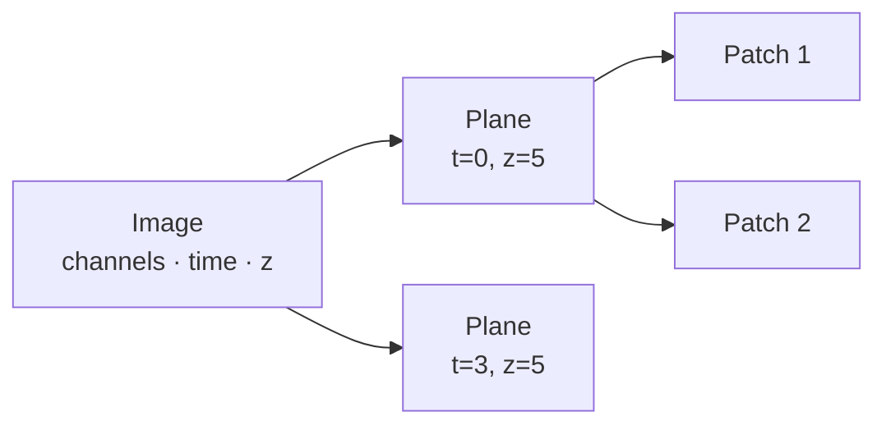

# How it works

A short tour of the ideas you will meet in the widgets, the YAML file and the rest of
these docs.

## The training set and its config

Each annotation project is a **training set**: a fixed selection of images, split into
training, validation and test, plus everything annotated for it. It is described by a
**configuration** (YAML) that says which OMERO container (or OME-Zarr images) to take
images from, which channel to annotate and how many images go into each split. You can
create it with the Jupyter widget or write it by hand; see the
[configuration reference](configuration.md).

A YAML file you write is a template: `TrainingSet.create(config, conn)` makes a new set
from it and never changes the file. The set keeps its own `config.yaml` (with its
identity, seed and the record of every annotation **session**, including your notes) in
its folder. `TrainingSet.open(table_id)` or `TrainingSet.open(folder)` continues a set;
see [resume or repeat a run](tutorials/resume-and-repeat.md).

## Where images come from

Images are read directly from an **OMERO container**: a project, dataset, plate, screen or
a single image. For plates you can keep only wells with certain key-value pairs, for
example `treatment: DMSO`. Images can also come from **OME-Zarr** files or URLs
(`source: zarr`, e.g. the BioImage Archive), without OMERO. Every image is identified by
a URI: `omero:image:<id>` or the Zarr address.

## Annotation units

You rarely annotate a whole multi-dimensional image. The pipeline cuts each image into
**annotation units**: one 2D plane (a chosen channel, timepoint and z-slice), or one 3D
volume if you switch on 3D mode. Timepoints and z-slices are each chosen as a list, all
of them, or `n` at random per image. With **patches** switched on, each plane is further cut
into smaller crops (for example 512 × 512 pixels), which are quicker to annotate and to
process on a CPU.



Every unit gets an ID such as `4ba674d4_0_5` (a short key of the image URI, timepoint, z-slice), and all files for
that unit are named after it.

## Train, validation and test sets

Images are picked **at random** from the container and assigned to a **training**,
**validation** or (optionally) **test** set. You either give counts (`train_n: 10`,
`validate_n: 3`) or annotate everything and give fractions. Counts are in images, not
units: one image with four patches gives four units.

## The two storage modes: OMERO or local

| | `storage: omero` (default) | `storage: local` |
|---|---|---|
| Writes to OMERO | yes: masks, ROIs, tracking table, config | nothing |
| Local folder | images, masks and `tracking_table.csv` | the same; it is the only copy |
| Typical use | your own data on your institute's server | public servers such as the IDR, OME-Zarr data, or a trial run |

Set it with `storage` in the config or the **Storage** choice in the widget. It is fixed
when the training set is created; OME-Zarr sets are always local.

## What ends up in OMERO

For a set with `storage: omero`, for each annotated unit:

- a **label mask** (TIFF, compressed losslessly) attached to the image,
- **polygon ROIs** on the image, visible in OMERO.web and OMERO.iviewer,

both tagged `omero-annotate-ai:<table id>:<unit id>` in their description, and for the
set as a whole:

- a **tracking table** on the container listing every unit, its split, whether it is
  done, the IDs of its mask and ROIs, and a pixel checksum of image and mask,
- the set's **config YAML** next to the table, updated after each session.

The tracking table is updated in place, so its ID never changes: that ID *is* the
training set's identity. The checksums let a resume or an export notice when a local
mask no longer matches the one on OMERO. With the `provenance` extra each unit also
gets an [ISCC](https://iscc.codes) Image-Code of image and mask, which tells *how much*
a file changed: a touched-up mask is reported as a near-duplicate, a replaced one as
different content.

## Batches

`workflow.batch_size` sets how many units napari shows at once. Each mask is saved to
the set's folder and uploaded as soon as the batch is closed; the OMERO table is updated
once per batch. With `0` everything is opened in one go. If something crashes, resuming
the set repairs what was half done (see
[Resume or repeat a run](tutorials/resume-and-repeat.md#what-resuming-repairs)).

## Sessions, notes and review

Every time you annotate, a **session** is recorded in the set's config: who, when, which
model, how many units were saved, and an optional note ("nuclei only, small debris
skipped"). The note can be edited later, also for earlier sessions. `ts.review()` (widget:
*Review annotated*) opens annotated units with their saved masks so you can correct them;
a changed mask replaces the label file and ROI on OMERO, an unchanged one is left alone.

## Several computers, one set

With `storage: omero` the OMERO table is the shared record, so a set can be opened on any
computer. Before napari shows a batch, the session **claims** its units in the table;
other sessions skip claimed units, and a unit someone else saved first is never uploaded
again (your mask is kept in `annotation_output/conflicts/`). Claims from your own earlier
runs on the same computer (after a crash or a dropped connection) never block you; other
computers' claims expire after `workflow.claim_hours` (default 6).

## Local folders

Each training set has one folder on your disk, with the same layout in every mode:

```text
~/omero_annotate_ai/                  ← home folder
├── <server>/<table id>_<name>/       a set tracked in an OMERO table
└── local/<id>_<name>/                a local (or OME-Zarr) set
    ├── config.yaml                   the config and progress, used to resume
    ├── tracking_table.csv            local copy of the progress table
    ├── annotation_input/             images as annotated: <unit id>.tif
    ├── annotation_output/            accepted masks: <unit id>_mask.tif
    ├── external_output/              masks from Cellpose or other tools, until collected
    ├── model_input/                  training channel(s), if different from the annotated one
    ├── ro-crate-metadata.json        RO-Crate description, written by ts.write_ro_crate()
    └── .scratch/                     micro-SAM's files for the current batch only
```

Choose another home folder with the `OMERO_ANNOTATE_AI_HOME` environment variable or
`home=` on `TrainingSet.create` / `TrainingSet.open`. Files are written atomically (a crash never
leaves half a file), and micro-SAM works in a fresh folder for every batch, so masks
always land on the image they were drawn on.

Training data is written to a separate folder; see
[Prepare training data](tutorials/training-data-prep.md).
