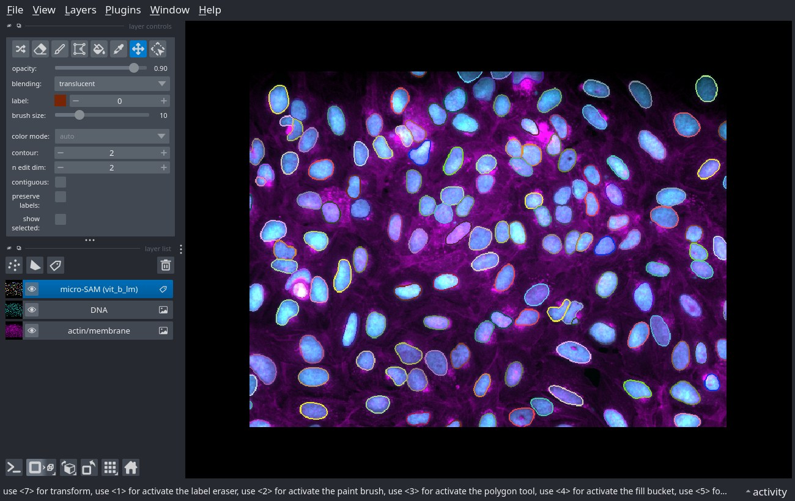
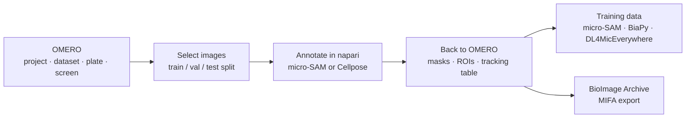

---
hide:
  - navigation
---

# OMERO Annotate AI

**Annotate your OMERO images with AI help, and get training-ready data out the other end.**

You pick images from an OMERO project, dataset, plate or screen. OMERO Annotate AI opens
them one by one in [napari](https://napari.org), where
[micro-SAM](https://github.com/computational-cell-analytics/micro-sam) suggests cell or
nucleus outlines that you accept or correct with a few clicks. You can also hand the images
to [Cellpose](https://www.cellpose.org) instead. The finished masks go back to OMERO, next
to the original images, and every choice you made is written down in one small YAML file.

<small>micro-SAM (`vit_b_lm`) segmentation of nuclei in a Cell Painting field from the
BioImage Archive (S-BIAD855), shown in napari.</small>

## What you get

-   :lucide-mouse-pointer-click: **Annotation without file juggling**

    Images are loaded straight from OMERO. No exporting, renaming or copying TIFFs by hand.

-   :lucide-database: **Results stored in OMERO**

    Masks, ROIs and a table of what was annotated are attached to your images, so
    colleagues can see them in OMERO.web. Interrupted runs resume without duplicates, and
    earlier masks can be reviewed and corrected.

-   :lucide-file-text: **A record of every run**

    One YAML file holds the images, channels, patches and train/validation/test split you
    used, and every session is recorded with an optional note. Open the set again to
    continue where you stopped, or share the YAML so others can repeat the run.

-   :lucide-brain: **Ready for model training**

    Turn the annotations into the folder layout that micro-SAM, BiaPy and
    DL4MicEverywhere expect, or package them for the BioImage Archive.

## How it works

[Read more about the main ideas](concepts.md) (annotation units, patches, the tracking
table, OMERO or local storage) before your first run.

## Where to start

-   **New here?**

    ---

    [Install the package](installation.md), then [try it on public IDR data](tutorials/public-data-idr.md).
    No OMERO account of your own is needed.

-   **Ready to annotate your own data?**

    ---

    Follow [Annotate with micro-SAM](tutorials/microsam-annotation-pipeline.md), the main
    tutorial. Using Cellpose? See [Annotate with Cellpose](tutorials/cellpose-integration.md).

-   **Have annotations already?**

    ---

    [Prepare training data](tutorials/training-data-prep.md) or
    [share them via the BioImage Archive](tutorials/bioimage-archive-export.md).

-   **Writing a config by hand?**

    ---

    The [configuration reference](configuration.md) lists every YAML option.

## What you need

- Access to an OMERO server: your institute's, or the public [IDR](https://idr.openmicroscopy.org) to try things out.
- A computer with a screen: napari opens a desktop window. A GPU makes micro-SAM much faster but is not required.
- Jupyter or [marimo](https://marimo.io) to run the [example notebooks](notebooks.md). The standard workflows need no programming beyond running notebook cells.

## Support

- Questions and bug reports: [GitHub issues](https://github.com/Leiden-Cell-Observatory/omero_annotate_ai/issues)
- Developed at the [Leiden Cell Observatory](https://github.com/Leiden-Cell-Observatory) within
  [NL-BioImaging](https://github.com/NL-BioImaging), funded by NWO.
