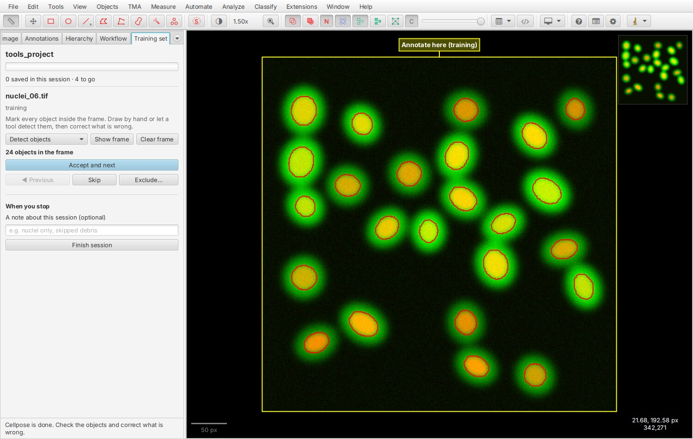
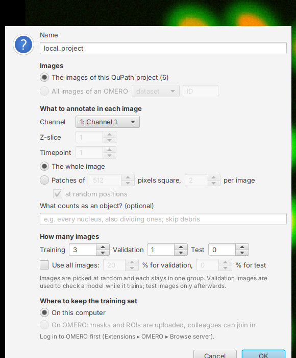

# QuPath extension (experimental)

!!! warning "Experimental"
    The extension annotates 2D planes and patches. 3D sets, plates with well filters
    and OME-Zarr sets are made and annotated with the Python package and its
    [napari plugin](napari-plugin.md).

Annotate a training set in [QuPath](https://qupath.github.io), one image at a time, with
whatever tool you like best there: the brush and wand, QuPath's cell detection,
[Cellpose](https://github.com/BIOP/qupath-extension-cellpose),
[InstanSeg](https://github.com/qupath/qupath-extension-instanseg), StarDist or
[SAM](https://github.com/ksugar/qupath-extension-sam). The extension adds a
**Training set** tab next to *Project*, *Image* and *Annotations*.


<small>The yellow frame marks what to annotate. Every object inside it becomes one
object of the mask.</small>

A training set made in QuPath is the same thing as one made with the Python package: the
same folder, the same tracking table and uploads on OMERO, the same `config.yaml`. You
can start a set in a notebook and annotate it in QuPath, review napari annotations in
QuPath, or the other way round, also with two people at the same time.

## Install

You need QuPath 0.6 or 0.7.

1. Get `qupath-extension-omero-annotate-ai-<version>.jar`: from the
   [releases page](https://github.com/Leiden-Cell-Observatory/omero_annotate_ai/releases)
   once a release carries it, or build it yourself (`./gradlew build` in
   `qupath-extension/`, see its README). Drag the jar onto the QuPath window and restart
   QuPath.
2. **For images and training sets on OMERO** (skip this for local images): install the
   official [QuPath OMERO extension](https://github.com/qupath/qupath-extension-omero)
   with *Extensions ▸ Manage extensions* and tick **Install optional dependencies** (the
   OMERO Java libraries). Training sets kept on OMERO need those libraries; the panel
   tells you if they are missing.

Nothing else is needed: no Python, no napari.

## The idea in one minute

- A **training set** is a selection of images, split at random into *training*,
  *validation* and *test*. You annotate them one by one.
- For each image the extension draws a locked **frame**: the whole image, or a patch of
  it. **Every object whose centre lies inside the frame becomes one object of the
  mask**, whether it is an annotation, a detection or a cell, drawn by hand or found by a
  tool. Objects with a class ending in `*` (such as `Ignore*`) are left out, and so is a
  region that encloses the frame (a tissue outline).
- **Accept** saves the mask and goes to the next image. Nothing else needs saving.
- The set is kept **on this computer** (a folder) or **on OMERO** (masks and ROIs are
  uploaded, a table on the dataset tracks progress, colleagues can join in).

## Use

### 1. Choose or make a training set

Open the **Training set** tab (or *Extensions ▸ OMERO Annotate AI ▸ Show the training
set panel*). It lists the sets on this computer and, when an OMERO image is open, the
sets of its dataset. Double-click one to open it. *More* opens a set from any folder or
by its OMERO table ID.

**New training set…** asks five things:

| | |
|---|---|
| **Images** | The images of the open QuPath project, or all images of an OMERO dataset or project (give its ID). |
| **What to annotate** | The channel (colour images such as H&E keep all three colours), z-slice and timepoint; the whole image or a number of patches per image. Use patches for large images: whole-slide images are too large to annotate in one piece. |
| **What counts as an object?** | Optional, but worth a line: "every nucleus, also dividing ones; skip debris". It is stored with the set. |
| **How many images** | For training, validation and test; or all images with a percentage for validation and test. Images are picked at random and each stays in one group. |
| **Where to keep it** | On this computer, or on OMERO. |



### 2. Annotate

Click **Annotate**. The first image opens with its frame selected.

1. Fill the frame with objects. *Detect objects* starts QuPath's cell detection or
   Cellpose on the frame; any other tool works the same way because the frame is
   selected: run InstanSeg or StarDist on it, prompt SAM inside it, or draw.
2. Correct what is wrong: delete, redraw, split, merge, with QuPath's own tools.
3. Press one of:
    - **Accept and next** (++ctrl+enter++, ++cmd+enter++ on a Mac) saves the objects
      in the frame as this image's mask and opens the next image. An image without
      objects asks for a second press, so empty images are saved on purpose only.
    - **Skip** leaves the image for a later session.
    - **Exclude…** leaves the image out of the training set for good (out of focus,
      artefact). It counts as done and is not exported.
    - **Previous** goes back; a saved image shows its objects, and accepting it again
      saves your corrections.

When you stop, add a short **note** ("nuclei only, bright ones") and click **Finish
session**. Closing QuPath in the middle records the session as interrupted; what you
accepted is saved, the rest stays for next time.

**Review** on the overview page goes through the annotated images again, also those
annotated in napari: their saved masks come back as editable objects. A changed mask
replaces the earlier one (on OMERO: the new upload first, then the old one is removed);
an unchanged one is left alone.

### 3. Use the result

**Export training data…** writes image and label pairs:

- *Image and label folders*: `train_input/`, `train_label/`, `val_…`, `test_…`, the
  layout of [Prepare training data](tutorials/training-data-prep.md), read by micro-SAM,
  BiaPy and DL4MicEverywhere.
- *Cellpose*: `train/ID.tif` with `train/ID_masks.tif`, and `test/`.

The Python package exports the same sets (`export_training_set`), with normalisation
and the BioImage Archive bundle on top.

!!! tip "Train Cellpose inside QuPath"
    The frames carry the classes **Training**, **Validation** and **Test**. The BIOP
    Cellpose extension trains from exactly that: rectangles classed *Training* and
    *Validation* with the objects inside them as annotations. A QuPath project
    annotated with this extension can be passed to its training script as it is (objects
    found as detections must be turned into annotations first).

## Working with detection tools

The extension does not care how objects get into the frame; these were tried with it:

| Tool | How | Tried with |
|---|---|---|
| **Cellpose** | *Detect objects ▸ Cellpose…* asks for the model and object diameter and runs the [BIOP Cellpose extension](https://github.com/BIOP/qupath-extension-cellpose) on the frame, on the channel the set annotates. Set the Cellpose Python path in QuPath's preferences first, as that extension describes. | Cellpose 3.1 (`cyto3`), BIOP extension 0.11.3 (QuPath 0.6) and 0.12.1 (QuPath 0.7) |
| **QuPath cell detection** | *Detect objects ▸ QuPath cell detection…* opens QuPath's own dialog for the frame. | QuPath 0.6 and 0.7 |
| **SAM** | Prompt inside the frame with the [SAM extension](https://github.com/ksugar/qupath-extension-sam); its annotations count like any other. | masks of a `samapi` 0.7.1 server (SAM 2 tiny) |
| **InstanSeg, StarDist, your own script** | Run it on the selected frame. | |
| **By hand** | Brush, wand, polygon. | |

Cellpose and the other detectors make objects for you to check, not finished masks:
delete what is wrong and draw what is missing before you accept.

!!! note "SAM extension and the OMERO Java libraries"
    With SAM extension 0.9.1, its requests failed in a QuPath that also had the OMERO
    Java libraries installed (both bring their own, different version of the Apache HTTP
    client). If you see `NoSuchMethodError … httpclient5` in the log, use SAM in a QuPath
    without the OMERO libraries, with sets kept on this computer.

## Sets on OMERO

Log in with the OMERO extension first (*Extensions ▸ OMERO ▸ Browse server*); the panel
uses that login, it never asks for your password.

For every accepted image the extension uploads, exactly like the Python package:

- the **label mask** (a compressed TIFF) attached to the image,
- the objects as **polygon ROIs**, visible in OMERO.web and iviewer,
- the image's row in the set's **tracking table**, and after each session the set's
  **config** with the session and your note.

**Several people, one set.** The image you are looking at is claimed in the table, so a
colleague annotating the same set (in QuPath or napari) gets other images. An image
somebody else saved first is not uploaded twice: your mask is kept in the set's folder
and the panel names the file.

**If OMERO is not reachable** when you accept an image, nothing is lost: the mask is
saved in the set's folder and the panel says so. The set's overview then shows
*Upload now*; a save that was cut off half-way is completed, not repeated.

If the panel cannot find your server (OMERO.web and the OMERO server are on different
machines, or the port is not 4064), enter `host:port` under *OMERO server address*.

## Where things are

Each set has one folder, the same as in the Python package (see
[Local folders](concepts.md#local-folders)), under `~/omero_annotate_ai` (or
`$OMERO_ANNOTATE_AI_HOME`):

```text
local/<id>_<name>/            a set kept on this computer
<server>/<table id>_<name>/   a set kept on OMERO
    config.yaml
    tracking_table.csv
    annotation_input/         the pixels you annotated: <unit id>.tif
    annotation_output/        the masks: <unit id>_mask.tif
    qupath/                   the set's QuPath project (if you had none open)
```

Your QuPath objects stay in the QuPath project, so you can keep working on them. If a
QuPath project is open when you start, the set's images are added to it; otherwise the
set gets its own project in its folder.

## Known limits

- 2D only. Sets with 3D volumes are refused with a message.
- New sets take their images from a QuPath project or an OMERO dataset or project.
  Plates, screens, well filters and OME-Zarr sources: make the set with the Python
  package, then annotate it in QuPath.
- A whole image must be smaller than 100 megapixels to be annotated in one piece; use
  patches for larger ones.
- Where objects overlap, the smaller one stays on top in the mask.
- A set kept on this computer whose images are local files can be exported and
  summarised by the Python package, but not annotated further in napari (napari reads
  images from OMERO or OME-Zarr).
- Images that have two different masks (one here, one on OMERO) are skipped and
  counted on the overview; resolve them as described in
  [Resume and repeat](tutorials/resume-and-repeat.md).
- The OMERO extension reads the original pixel values (16-bit, more than three
  channels) through its *Ice* or *Pixel Buffer Microservice* pixel API, not through the
  *web* API. Choose one of them in the OMERO extension's settings if such an image does
  not open.
