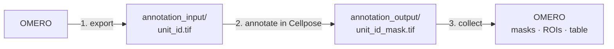

# Annotate with Cellpose

Prefer drawing in the [Cellpose](https://www.cellpose.org) GUI, or want to correct
Cellpose predictions instead of using micro-SAM? This workflow exports the selected
images from OMERO, lets you annotate them in any tool, and then collects the masks and
uploads them to OMERO.



Notebooks: [Jupyter](https://github.com/Leiden-Cell-Observatory/omero_annotate_ai/blob/main/notebooks/jupyter/annotation/omero-annotate-ai-cellpose.ipynb)
· [marimo](https://github.com/Leiden-Cell-Observatory/omero_annotate_ai/blob/main/notebooks/marimo/omero-annotate-ai-cellpose.py)

Cellpose itself is not installed with this package. Add it to your environment with
`pixi add cellpose` (or `pip install cellpose`), or use an existing Cellpose installation.

## 1. Connect, configure and export

Connect and configure exactly as in the
[micro-SAM tutorial](microsam-annotation-pipeline.md) (steps 1 and 2). The SAM model
setting is ignored. Then export the images:

```python
pipeline = create_pipeline(config, conn)
table_id, config = pipeline.run_cp_workflow()
```

This creates the tracking table in OMERO and writes one TIFF per annotation unit to
`annotation_input/` in your working directory, named after the unit, for example
`12345_0_0.tif`. No napari window opens and no display is needed.

!!! note
    Units are marked as *processed* as soon as their image is exported, so the progress
    summary counts exported images, not finished masks. Use
    `get_annotation_status_from_disk()` (below) to see which masks are still missing.

## 2. Annotate

Open the images in `annotation_input/` in the Cellpose GUI (`cellpose` on the command
line). Run a model, correct the outlines, and **save each result as a label image** in
`annotation_output/` with the same name plus `_mask.tif`:

```text
annotation_input/12345_0_0.tif   →   annotation_output/12345_0_0_mask.tif
```

!!! warning "Use the `_mask.tif` naming"
    Cellpose's own `_seg.npy` and `_cp_masks.png` files are not picked up. Export or
    convert the masks to a label TIFF (0 = background, 1, 2, 3 … = objects) with the
    name above. Any tool that writes label TIFFs works: napari, QuPath, Fiji or a script.

You can annotate in several sittings. Check what is still missing with:

```python
status = pipeline.get_annotation_status_from_disk()
print(status)
```

## 3. Collect and upload

```python
n_done, config = pipeline.collect_annotations_from_disk()
```

Each mask is matched to its unit by name and uploaded as a mask attachment plus ROIs,
and the tracking table is updated. Running it again only handles new masks. In
read-only mode the masks stay local and `tracking_table.csv` is updated instead.

## Next

[Prepare training data](training-data-prep.md) from the collected annotations, for
example to fine-tune a Cellpose model on your own images.
