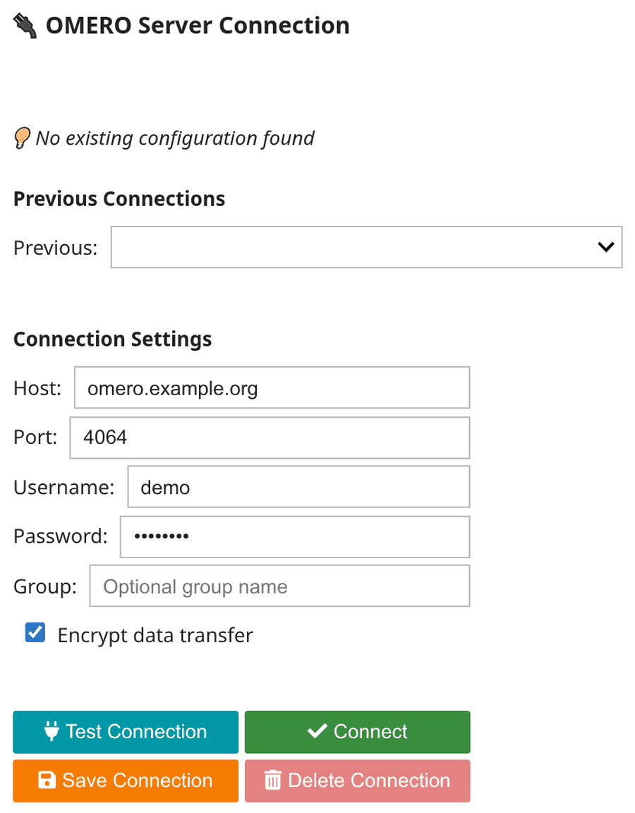
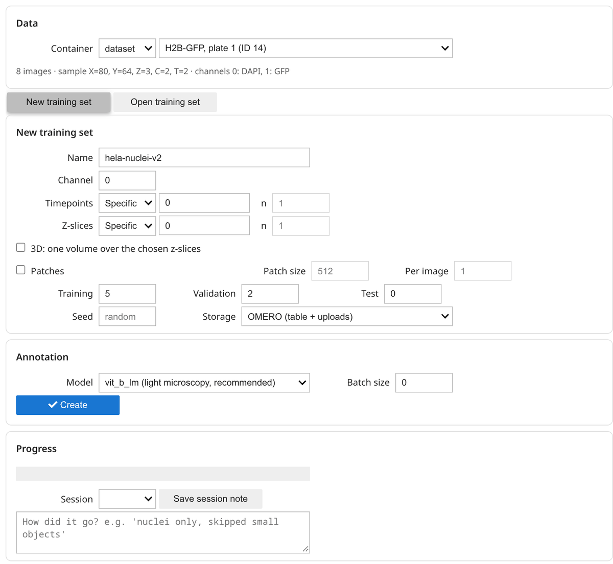
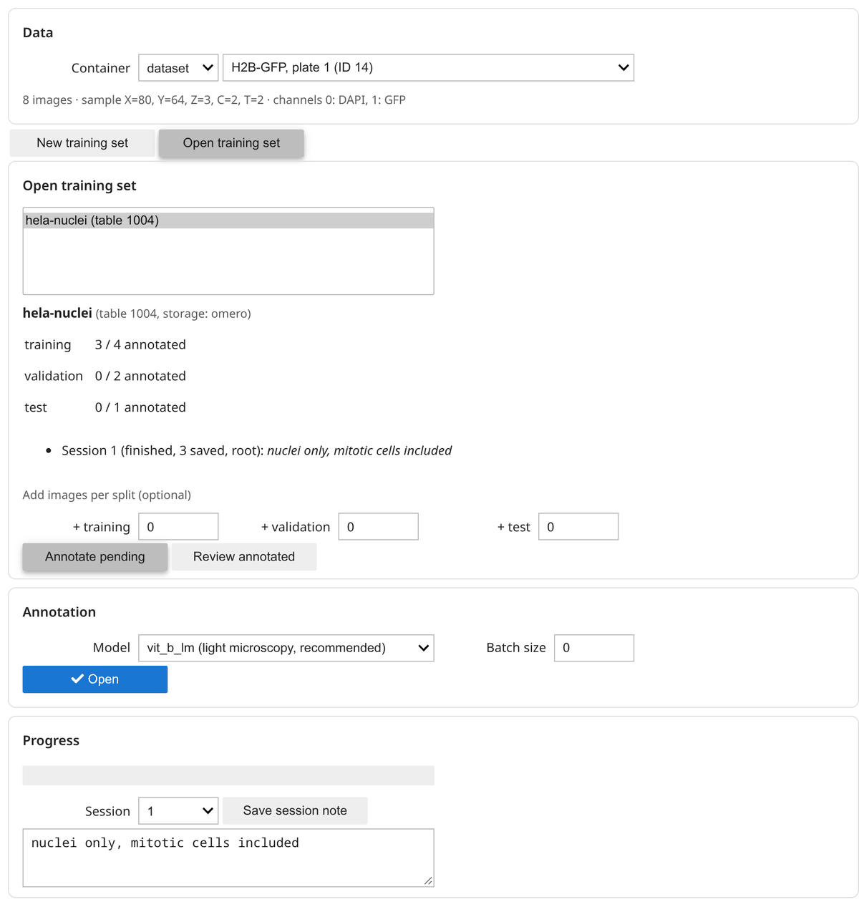

# Annotate with micro-SAM

This is the main tutorial. You will connect to OMERO, choose images, annotate them in
napari with micro-SAM, and find the results back in OMERO. It takes about 20 minutes plus
the time you spend annotating.

!!! note "Before you start"
    - OMERO Annotate AI is [installed](../installation.md) and Jupyter is running.
    - You can log in to an OMERO server and know the ID of a dataset, project, plate or
      screen with images (visible in OMERO.web next to the name).
    - You are on a machine with a screen: napari opens a separate window.

The steps below follow the notebook
[`omero-annotate-ai-annotation-widget.ipynb`](https://github.com/Leiden-Cell-Observatory/omero_annotate_ai/blob/main/notebooks/jupyter/annotation/omero-annotate-ai-annotation-widget.ipynb).
Download it, or copy the code blocks into a new notebook.

## 1. Connect to OMERO

```python
from omero_annotate_ai import (
    TrainingSet,
    create_omero_connection_widget,
    create_workflow_widget,
)

conn_widget = create_omero_connection_widget()
conn_widget.display()
```

Fill in the server address, your username and password, and click **Connect**. Instead
of username and password you can paste a *session key*, e.g. from a session you started
in OMERO.web.



The widget remembers the server and username for next time (in
`~/.omero-annotate-ai/connections.json`), but never your password: you type it each
time.

Then, in the next cell:

```python
conn = conn_widget.get_connection()
```

## 2. Configure the run

```python
workflow_widget = create_workflow_widget(connection=conn)
workflow_widget.display()
```

The widget has one screen, in cards:

**Data.** Choose the container type (project, dataset, plate, screen) and the container.
A line below shows the number of images, a sample image's dimensions and its channel names.

**New training set** or **Open training set.** For a first run choose *New*:



| Setting | What to choose |
|---|---|
| Name | A short, descriptive name such as `hela_nuclei_v1`; used for the OMERO table and the local folder. |
| Channel | The channel you will draw on, e.g. the DAPI channel for nuclei. Channel numbers start at 0. |
| Timepoints, Z-slices | Which planes to annotate: *Specific* (a list such as `0, 3, 5-7`), *All*, or *Random* (`n` drawn per image with the seed). For 2D images leave them at *Specific* `0`. |
| 3D | Annotate one volume over the chosen z-slices instead of single planes (e.g. z-slices *Specific* `10-20`, or *All*). |
| Patches | Annotate crops instead of whole images, with patch size and patches per image. Recommended for large images or a CPU-only computer. |
| Training / Validation / Test | How many images to annotate for each split. Start small, e.g. 5 and 2. |
| Seed | Empty picks one at random and stores it, so the selection can be repeated. |
| Storage | *OMERO* uploads masks and keeps a tracking table; *Local folder only* writes nothing to OMERO. |

*Open* lists the training sets on the container (and local ones). Selecting one shows its
progress per split and the notes of earlier sessions; you can add images per split, and
choose *Annotate pending* (the default) or *Review annotated* (see
[Correct earlier annotations](#correct-earlier-annotations)).



**Annotation.** The SAM model (`vit_b_lm` for light microscopy, `vit_b_em_organelles` for
electron microscopy) and the batch size (images per napari session, 0 = all; the masks of a
batch are saved and uploaded when you close its napari window). Click **Create** or **Open**.

!!! tip "Not sure what a setting means?"
    [How it works](../concepts.md) explains annotation units, patches and the two modes.
    The [configuration reference](../configuration.md) lists every option.

## 3. Annotate in napari

```python
ts = workflow_widget.training_set()
workflow_widget.annotate(note="nuclei only")  # the note is stored with this session
```

Progress appears in the widget's **Progress** card. After the session the note box shows
the session's note; edit it and click **Save session note** to replace it (one note per
session). To change an earlier session's note, open the set and pick the session next to
the note box. Without the widget, `TrainingSet.create(config, conn)`
and `ts.annotate(...)` do the same.

Creating the set:

1. picks images (reproducibly, from the stored seed) and assigns them to training,
   validation and test,
2. creates the tracking table in OMERO (not for `storage: local`) and the set's folder,

and `annotate` downloads the first batch and opens it in napari with the micro-SAM annotator. To continue
later, open the set again with `TrainingSet.open(ts.table_id, conn)`.

The first time, micro-SAM downloads its model (a few hundred MB). For each image it then
computes an *embedding*; this is what makes the clicks fast afterwards, and takes a few
seconds on a GPU or longer on a CPU.

### Correct earlier annotations

To check or fix masks you already saved, open the set, choose **Review annotated** and
run the same cell, or call `ts.review()`:

```python
ts.review(note="tightened the outlines")  # every annotated unit
ts.review(ids=["4ba674d4_0_0"])  # or only some (annotation IDs)
```

Each unit opens in napari with its saved mask (downloaded from OMERO if your folder lacks
it); correct it with micro-SAM or napari's label tools and go to the next image as usual.
A changed mask replaces the old label file and ROI on OMERO; an unchanged one is left
alone. The session is recorded as a review, with the number of masks it changed.

### In napari

The micro-SAM image series annotator shows one image at a time.

1. With the `point_prompts` layer selected, click on an object to place a **positive
   point**, or use the `prompts` layer to draw a box around it. Press ++t++ to switch to
   **negative** points, which tell SAM what is *not* part of the object.
2. Press ++s++ to segment the object from your prompts. Correct it by adding more points
   and pressing ++s++ again.
3. Press ++c++ to **commit** the object. It is added to the label layer and gets its own
   colour. (++shift+c++ clears the current prompts and segmentation.)
4. Repeat for every object. To speed things up, use **Automatic Segmentation** in the side
   panel, then fix mistakes with napari's label tools.
5. Click **Next Image** (or press ++n++) to save the mask and go to the next image.
   In 3D mode, ++shift+s++ extends the segmentation through the volume.

When the last image of the batch is done, close the napari window. The masks are then
uploaded and the next batch, if any, opens.

See the [micro-SAM documentation](https://computational-cell-analytics.github.io/micro-sam/micro_sam.html)
for all annotator features and shortcuts.

!!! warning "The notebook cell waits for napari"
    The cell keeps running until you close the last napari window. That is normal.

## 4. Check the results

In the notebook:

```python
done = sum(row.processed for row in ts.units())
print(f"{done} of {len(ts.units())} units annotated; folder: {ts.bundle_dir}")
```

In OMERO.web (`storage: omero`):

- Each annotated image now has **ROIs** (open it in OMERO.iviewer) and a **mask file**
  in its attachments.
- The container has a **table** named after your training set, listing every unit and
  whether it is done, plus the set's **configuration file** as an attachment.

Every set also has a local folder (`ts.bundle_dir`) with the images and masks in
`annotation_input/` and `annotation_output/`, a `tracking_table.csv` and its
`config.yaml`.

## 5. What next?

- Stopped half-way? [Resume the run](resume-and-repeat.md).
- Want to repeat it on another dataset? Save the config and
  [run it from YAML](resume-and-repeat.md#repeat-a-run-from-a-yaml-file).
- Enough annotations? [Prepare training data](training-data-prep.md) and fine-tune a
  model on your own images.

## Variations

??? example "Annotate one channel, train on another"
    Draw nuclei on a fluorescent channel but train a model that predicts them from
    brightfield: set `label_channel` to the fluorescent channel and `training_channels`
    to the brightfield channel. The brightfield images are saved in `model_input/`.

    ```yaml
    spatial_coverage:
      channels: [0, 1]
      label_channel: 0
      training_channels: [1]
    ```

??? example "Show extra channels for context"
    `context_channels` are shown in napari next to the channel you annotate (e.g. a
    membrane stain while you draw cytoplasm) but never used for training.

    ```yaml
    spatial_coverage:
      channels: [0]
      context_channels: [1, 2]
      context_channel_names: [membrane, actin]
    ```

??? example "Only some wells of a plate"
    Keep only wells whose key-value pairs match:

    ```yaml
    omero:
      container_type: plate
      container_id: 456
      well_filters:
        treatment: [DMSO, control]
      well_filter_mode: include    # or exclude
    ```

??? example "3D volumes"
    ```yaml
    spatial_coverage:
      three_d: true
      z_slices: [0, 1, 2, 3, 4, 5, 6, 7, 8, 9]   # the range of the volume
    ```
    Each timepoint becomes one volumetric unit and opens in micro-SAM's 3D annotator.

??? example "Without the widgets"
    ```python
    import getpass
    from omero_annotate_ai import TrainingSet, load_config_from_yaml
    from omero_annotate_ai.omero.simple_connection import SimpleOMEROConnection

    conn = SimpleOMEROConnection().connect(
        host="omero.example.org", username="me", password=getpass.getpass()
    )
    config = load_config_from_yaml("annotation_config.yaml")
    ts = TrainingSet.create(config, conn)
    ts.annotate()
    ```
